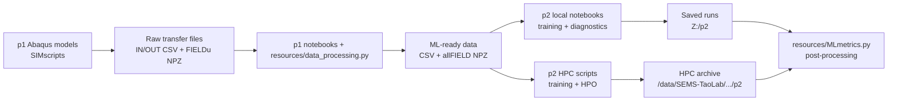

# Niccolo Forte's PhD Repository

This repository contains the scripts, notebooks, and shared Python helpers used throughout my PhD work on disordered lattice materials. It is organized by paper/project folder, with a shared top-level `resources` package that carries the reusable mechanics, Abaqus post-processing, data-processing, machine-learning, and diagnostics code.

At a high level:

- `p1-DisorderLatticeProperties/` generates and post-processes Abaqus finite-element simulations of quasi-disordered 2D lattices.
- `p2-DisorderML/` trains and diagnoses machine-learning surrogate models that map lattice disorder to mechanical response.
- `p3-DisorderIcingMitigation/` contains early Abaqus simulation work for disorder-enabled ice-mitigation concepts.
- `resources/` is the shared package that connects the paper folders.

## Quick Start

The primary checkout on this Windows machine is `Z:\00-PhD-gitRepo`. Use it for project source folders, local commands, and Python/Abaqus import hooks when replacing references to the former Documents checkout. Historical messages and records may still mention that former path.

From the repository root, run:

```powershell
.\setup-Windows.ps1
```

On macOS, run:

```bash
./setup-macOS.sh
```

The Windows script sets up the shared `resources` package for both standard Python and Abaqus Python. The macOS script creates or refreshes the isolated `nf-phd` Conda environment for standard Python; Abaqus is not available on macOS. Both scripts verify imports from outside the repo root. After setup, code can use imports such as:

```python
from resources.MLdata import DATA
from resources.lattices import Geometry
from resources.data_processing import create_inputCSV, create_outputCSV
```

On Windows, `-OnlyPython` and `-OnlyAbaqus` select one interpreter. Pass `-remove` to either platform script to reverse its setup.

The root `requirements.txt` is set up for a standard local Python environment, including CPU PyTorch wheels. The GPU/HPC machine-learning environment is managed separately by `p2-DisorderML/HPC/B0_ML-env-setup.sh`.

For an isolated Windows Python environment, create it once in the primary checkout, activate it, and select the Python-only setup:

```powershell
Set-Location 'Z:\00-PhD-gitRepo'
python -m venv .venv311
. .\.venv311\Scripts\Activate.ps1
.\setup-Windows.ps1 -OnlyPython
```

On later sessions, activate the existing environment; creation is unnecessary. The setup script uses the `python` selected on `PATH`; it does not create or activate a virtual environment itself. Recreate virtual environments when relocating a checkout, since installed launchers and editable imports can retain absolute paths. Generated caches and package metadata are rebuilt rather than copied. Abaqus uses its separate interpreter and setup.

## Agent Guidance And Repo Skills

The independent-model accuracy follow-ups are documented in
[the p2 run guide](p2-DisorderML/HPC/DualOutputs/README.md#case-1i-input-and-custom-loss-studies).
The Case1(i) continuation now uses50/50 predicted/true curve training and raw
predicted fields at deployment, without a correction model.
The [cost-aware follow-up](p2-DisorderML/samples/field-input-study/correction-cost.md)
explains this choice; the original measured accuracy comparison remains evidence,
not the active source policy.
The [Markdown visual report](p2-DisorderML/samples/field-input-study/README.md)
includes all16 figures inline and is available only in the Z: checkout. Rebuild
it with maintained `HPC/studies/Input/review_field_inputs.py` using an explicit canonical
samples output directory. The custom-loss continuation reuses12 compatible field
banks and adds18 curve-only jobs plus a disposable gate; launchers preview first.

Repository guidance is tracked with the code so a fresh checkout carries the same working agreements:

- Start with the root `AGENTS.md`, then read the closest nested `AGENTS.md` before working in a paper folder, notebook folder, HPC folder, or `resources/`.
- The root and nested `AGENTS.md` files provide the minimum repository and local context. Agents should additionally consult the relevant README sections for unfamiliar or cross-project work and for setup, navigation, commands, workflows, interpretation, or maintenance; repository-wide or unclear-scope work requires the full README.
- Project-specific guidance includes `p1-DisorderLatticeProperties/AGENTS.md`, `p2-DisorderML/AGENTS.md`, `p3-DisorderIcingMitigation/AGENTS.md`, and `resources/AGENTS.md`.
- Each paper has a `PROJECT_STATUS.md` for repository continuation and handoff: implementation state, verified runs, blockers, and the next computational task. These are independent Markdown files, not synced copies of Obsidian notes. Keep scientific planning and manuscript development in Obsidian; reference that context without maintaining a second detailed research plan here. Durable rules stay in `AGENTS.md`.
- Repo-scoped skills live under `.agents/skills/`. `maintain-repo-guidance` keeps instructions synchronized, `validate-repo-change` selects proportionate checks, `review-p1-p2-data-contract` protects the FEA-to-ML producer-consumer boundary, and `operate-p2-hpc` loads cluster procedures only for relevant work.
- Human-facing setup, structure, commands, workflows, and limitations belong in this README and must stay current whenever those facts change. Agent-specific routing, safety, and validation rules belong in the closest relevant `AGENTS.md`. Reusable procedures belong in a skill.
- Current guidance should be edited in place; Git history records the chronology.

Before completing a change, run:

```powershell
python .agents/skills/validate-repo-change/scripts/validate_repo.py --changed
```

Useful broader scopes are `--scope resources`, `--scope p1`, `--scope p2`, `--scope p3`, `--scope contract`, and `--scope all`. The validator:

- runs `git diff --check` and the guidance-integrity checker, which reports every effective `AGENTS.md` chain, warns above 24 KiB, and fails above 32 KiB;
- recognises `p2-DisorderML/WINNER.md` as guidance and preserves all checker errors in failure summaries, even when size warnings are also present; CI runs regression tests for both behaviours;
- accepts ancestor READMEs for changes within their subtree, including study READMEs; documentation in a sibling study does not cover shared resources;
- compiles selected Python without executing it and labels Abaqus-dependent code `SYNTAX-ONLY`;
- imports applicable `resources` modules in fresh Python processes;
- checks notebook JSON/required structure, `bash -n`, and PowerShell parsing when those interpreters are available;
- checks the explicitly non-scientific contract fixture for aligned sample ids, periodic id `0`, field shapes/metadata, and CSV/NPZ serialization;
- reports Abaqus, Slurm/HPC, external `Z:` data, saved-run, and scientific execution as `SKIP` when they were not exercised.

After committing and before pushing, also run the validator with
`--base-ref <remote-tip-before-push>` to check the same committed range as CI.
`--changed` checks uncommitted files only; a clean checkout does not validate the
pending push. Local guidance acknowledgements are not persisted to CI.

Study-report refreshes preserve completed diagnostic sections. Replacing the
prediction-variation section stops at the next level-two heading and leaves
other sections intact; refresh the base report before inserting that diagnostic.
The shared implementation is `resources/MLstudy_reports.py`, used by the Loss
and Damage report builders.

The synthetic fixture contains only minimal identities and shapes, not experimental or simulated research values. It detects structural breakage; it cannot establish scientific correctness. The `.github/workflows/guidance-integrity.yml` workflow runs the changed-surface validator on pushes and pull requests to the public GitHub.com mirror, using Node 24-based v7 checkout and Python setup actions. The job is skipped before runner allocation on the QMUL Enterprise mirror because that server currently cancels runner-backed jobs; this prevents misleading cancellation warnings while the public mirror remains the authoritative remote CI host. Local validation remains required.

The `review-p1-p2-data-contract` skill treats the boundary like an internal API: p1 writes named, indexed CSV/NPZ products; shared resources transform/load them; p2 assumes the same identity, shape, metadata, and saved-run layout. Use it when a change could make one stage produce data that another stage misreads even though both stages still run.

`update-repo.ps1` is a legacy manual multi-checkout workflow, not a setup or validation command. It runs pulls, broad staging, commits, pushes, and an SSH login against hard-coded local, OneDrive, `Z:`, and QMUL HPC locations. Do not run it without explicitly reviewing and confirming every target; whether it should be retired or redesigned is `Decision required`.

## Retained Research References

Capture sources when they are actually used in retained methods, code, analyses,
reports or presentations, before their chat is archived. Follow
[ZoteroLibraryManager's reference workflow](https://github.com/niccoforte/ZoteroLibraryManager/blob/main/docs/retained-reference-capture.md)
for verification, live-library deduplication, collection placement and one private
shared intake. Preserve what each source supports for manuscript writing. Pending
entries are not completed imports; speculative and abandoned reading stays out.
Library/intake contents remain private and outside this public repository.
Borderline candidates require an explicit author decision before addition;
an accepted source awaiting write access is a different state.

## Git Remotes And Dual Push

Complete repository changes by validating, committing and pushing the intended
work. Pull before publishing and verify that the local branch and both remote
branches match. Any synchronization blocker must be reported before handoff.

The intended setup fetches from QMUL GitHub while a single `git push` publishes the current branch to both QMUL GitHub and the public GitHub.com mirror. Configure each fresh clone once because push URLs live in that clone's local `.git/config` and are not versioned:

```powershell
git remote set-url origin https://github.qmul.ac.uk/exy053/NF-PhD-gitRepo.git
git config --unset-all remote.origin.pushurl
git config --add remote.origin.pushurl https://github.qmul.ac.uk/exy053/NF-PhD-gitRepo.git
git config --add remote.origin.pushurl https://github.com/niccoforte/NF-PhD-gitRepo.git
git remote -v
```

After that, ordinary `git pull`/`git fetch` use the single QMUL fetch URL, while `git push` or `git push origin main` pushes to both configured destinations. Authentication must work for both servers.

A multi-destination push is not atomic: one server can accept a commit before the other rejects it or becomes unavailable. If `git push` reports any failure, compare both remote branch tips before retrying:

```powershell
git ls-remote https://github.qmul.ac.uk/exy053/NF-PhD-gitRepo.git refs/heads/main
git ls-remote https://github.com/niccoforte/NF-PhD-gitRepo.git refs/heads/main
```

Do not set these `origin` push URLs globally, because that would affect unrelated repositories that also call their remote `origin`.

## Repository Map

```text
00-PhD-gitRepo/
+-- AGENTS.md
+-- README.md
+-- .agents/
|   +-- skills/
|       +-- maintain-repo-guidance/
|       +-- operate-p2-hpc/
|       +-- review-p1-p2-data-contract/
|       +-- validate-repo-change/
|           +-- scripts/
|           |   +-- validate_repo.py
|           +-- fixtures/
|               +-- synthetic_contract/
|                   +-- contract.json
+-- .github/
|   +-- workflows/
|       +-- guidance-integrity.yml
+-- pyproject.toml
+-- requirements.txt
+-- requirements-abaqus.txt
+-- setup-Windows.ps1
+-- setup-macOS.sh
+-- update-repo.ps1
+-- p1-DisorderLatticeProperties/
|   +-- AGENTS.md
|   +-- PROJECT_STATUS.md
|   +-- code/
|   |   +-- AGENTS.md
|   |   +-- DataProcessing.ipynb
|   |   +-- InputsOutputs.ipynb
|   |   +-- SIMresults.ipynb
|   |   +-- StiffnessMatrix.ipynb
|   |   +-- ContinuumPlots.ipynb
|   |   +-- ValConvPlots.ipynb
|   |   +-- AK-*.ipynb and exploratory notebooks
|   +-- SIMscripts/
|       +-- AGENTS.md
|       +-- A1_FractureToughness-Ductility.py
|       +-- A2_INpostProcess.py
|       +-- A2_OUTpostProcess.py
|       +-- A2_FieldOUTpostProcess.py
|       +-- A3_ContinuumPP.py
|       +-- B1_ABAQUS-new.sh
|       +-- B1_ABAQUS-inp-rerun.sh
|       +-- B2_ABAQUS-PPscratch-new.sh
|       +-- B3_ABAQUS-transfer.sh
|       +-- B3_ABAQUS-archive.sh
|       +-- run-local.ps1
|       +-- odbUpgrade.py
|       +-- OldScriptVersions/
+-- p2-DisorderML/
|   +-- AGENTS.md
|   +-- PROJECT_STATUS.md
|   +-- handoffs/
|   |   +-- HANDOFFS.md
|   |   +-- HANDOFF-*.md
|   |   +-- TOKENIZATION_NEXT_STEPS.md
|   +-- code/
|   |   +-- AGENTS.md
|   |   +-- ML-CurveOutputs.ipynb
|   |   +-- ML-FieldOutputs.ipynb
|   |   +-- ML-FieldToCurveOutputs.ipynb
|   |   +-- ML-CurvePostProcessing.ipynb
|   |   +-- ML-FieldPostProcessing.ipynb
|   |   +-- ML-HPOpostProcess.ipynb
|   |   +-- Tokenization.ipynb
|   |   +-- exploratory/prototype notebooks
|   +-- HPC/
|       +-- AGENTS.md
|       +-- B0_ML-env-setup.sh
|       +-- B1_ML-new.sh
|       +-- B2_ML-resumeHPO.sh
|       +-- B3_ML-transfer-mac.sh
|       +-- B3_ML-transfer-windows.sh
|       +-- CurveOutputs/
|       +-- FieldOutputs/
|       +-- FieldToCurve/
|       +-- FieldToProperty/
|       +-- DualOutputs/
|           +-- A0-HPC-Dual-test.py
|           +-- test_dual_contract.py
+-- p3-DisorderIcingMitigation/
|   +-- AGENTS.md
|   +-- PROJECT_STATUS.md
|   +-- SIMscripts/
|       +-- A1_IcingModels.py
+-- resources/
    +-- AGENTS.md
    +-- abaqus.py
    +-- calculations.py
    +-- data_processing.py
    +-- lattices.py
    +-- MLdata.py
    +-- MLfunc.py
    +-- MLfield.py
    +-- MLdual.py
    +-- MLmetrics.py
    +-- MLmodels.py
    +-- tokenization.py
    +-- utilities.py
```

GitHub can render the workflow diagram below as a Mermaid chart:



## Research Vocabulary

The same terms appear across Abaqus scripts, data-processing notebooks, and ML code:

- `Ductile` or `UT`: uniaxial/ductile branch, usually stress-strain response. Derived properties include ductility, strength, stiffness, and work of fracture.
- `Fracture` or `FT`: compact-tension/fracture branch, usually force-displacement response. Derived properties include force/displacement at fracture and toughness metrics such as `K_IC` and `K_JIC`.
- `MULTI` or `both`: aligned UT and FT samples used together.
- `per`: periodic/reference lattice case. In processed data this is treated as simulation id `0`.
- `disNodes`: nodal disorder.
- `disStruts`: strut-thickness disorder.
- `FIELDu`: displacement field-output data exported from Abaqus ODBs.

## Paper 1: Disorder Lattice Properties

`p1-DisorderLatticeProperties/` is the finite-element and data-generation layer. It creates quasi-disordered 2D lattice simulations, extracts input/output data from Abaqus files, and prepares the mechanical data used later by p2.

### `p1-DisorderLatticeProperties/SIMscripts/`

This folder contains the active local and HPC Abaqus workflow.

| File | Role |
| --- | --- |
| `A1_FractureToughness-Ductility.py` | Main Abaqus CAE model generator for ductile/uniaxial and fracture/compact-tension simulations. Handles lattice geometry, nodal/strut disorder, material laws, boundary conditions, output requests, and job writing/submission. |
| `A2_INpostProcess.py` | Parses `.inp` files and exports input-side transfer CSVs for node positions, strut thicknesses, and frequency-disorder parameters. |
| `A2_OUTpostProcess.py` | Parses `.odb` history outputs and writes curve-side `OUT-Ductile...csv` and `OUT-Fracture...csv` files. |
| `A2_FieldOUTpostProcess.py` | Parses `.odb` field outputs and writes per-simulation `FIELDu-...npz` files with displacement fields, node labels, coordinates, frames, components, masks, and source metadata. |
| `A2_DamageOUTpostProcess.py` | Read-only export of one supported Ti FCC B21 ODB/INP. Full audit: `strut_damage_v1`; `--status-only`: lean `strut_status_v1` with whole-element STATUS, native parent membership and actual frames. Uses named arguments. |
| `A2_DamageBatch.py` | Explicit FCC-only archive inventory and resumable STATUS batches through the same exporter, with scratch copies, source/code hashes and FIELDu alignment checks. |
| `A3_ContinuumPP.py` | Older continuum-style displacement post-processing helper for `frame*.csv` and `NodesElems.csv` outputs. |
| `B1_ABAQUS-new.sh` | Main Slurm wrapper. Stages scripts and `resources/` to scratch, runs Abaqus generation/post-processing, and archives outputs. |
| `B1_ABAQUS-inp-rerun.sh` | Runs existing `.inp` files and can post-process them in place. |
| `B2_ABAQUS-PPscratch-new.sh` | Legacy archived post-processing plus explicit manifest-driven `--damage-only` batches; see `SIMscripts/DAMAGE.md`. |
| `B3_ABAQUS-transfer.sh` | Transfers `transfer/` files and archives between QMUL HPC and local `Z:/p1/data/Ti`. |
| `B3_ABAQUS-archive.sh` | Resumable, download-only Windows mirror of the complete HPC p1 archive into `Z:/p1/HPCarchive`; preserves relative directories, including non-Ti content. |
| `run-local.ps1` | Local Windows launcher for Abaqus testing. |
| `odbUpgrade.py` | ODB upgrade helper. It can delete old ODBs depending on configuration, so treat it carefully. |

The active A1/A2 Abaqus scripts share a positional command contract after `--`:

```text
LAT nnx unitCellSize mode material rD DIS fac distribution target initial nJobs CPUs Fout Hout pDir
```

`OldScriptVersions/` contains historical Abaqus, UGE, and Akash-origin scripts. These are useful for provenance but should not be treated as the active workflow unless explicitly needed.

#### Download the complete p1 archive to Windows

Use [B3_ABAQUS-archive.sh](p1-DisorderLatticeProperties/SIMscripts/B3_ABAQUS-archive.sh), not the selective/consolidating B3 transfer mode. It copies the contents of `/data/SEMS-TaoLab/Niccolo-Forte/p1/` directly into `Z:/p1/HPCarchive/`: for example, remote `p1/Ti/data/...` becomes local `HPCarchive/Ti/data/...`. It does not filter file types, extract archives, change model metadata or alter existing notebook data paths.

The PC already has Git Bash, Python and PuTTY. Authenticate the shared `HPC` PuTTY session and leave it open. In Git Bash:

```bash
# Offline plan only: no connection or filesystem writes
bash /z/00-PhD-gitRepo/p1-DisorderLatticeProperties/SIMscripts/B3_ABAQUS-archive.sh --dry-run

# Start the full download; rerun the same command after an interruption
bash /z/00-PhD-gitRepo/p1-DisorderLatticeProperties/SIMscripts/B3_ABAQUS-archive.sh

# Optional later paths/types/file-size comparison, without downloading
bash /z/00-PhD-gitRepo/p1-DisorderLatticeProperties/SIMscripts/B3_ABAQUS-archive.sh --check-only
```

To see live progress in the same PowerShell window, run in the foreground:

```powershell
& 'C:\Program Files\Git\bin\bash.exe' 'Z:/00-PhD-gitRepo/p1-DisorderLatticeProperties/SIMscripts/B3_ABAQUS-archive.sh'
```

The initial remote inventory/local checks can take minutes. During downloads,
progress updates every five seconds: bytes/percentage remaining for this run,
completed-file count, average speed and the current file's downloaded size.
Missing/empty files use `get`; nonempty partial files use `reget`; completed
files are skipped by size. Ctrl+C stops the transfer client but leaves the shared
PuTTY session open, retaining partial files and the resume marker. Rerun the same
command to resume; do not run two copies against the same destination.

Alternatively, launch in the background from PowerShell (progress goes to logs):

```powershell
Start-Process -WindowStyle Hidden -FilePath 'C:\Program Files\Git\bin\bash.exe' `
  -ArgumentList 'Z:/00-PhD-gitRepo/p1-DisorderLatticeProperties/SIMscripts/B3_ABAQUS-archive.sh' `
  -RedirectStandardOutput 'Z:\p1\HPCarchive-download.log' `
  -RedirectStandardError 'Z:\p1\HPCarchive-download.err.log'
```

Keep the PC awake and the p1 source unchanged until the copy and any resumes finish. The active resume marker is `Z:/p1/HPCarchive.resume.json`, outside the mirrored tree; do not delete it while an interrupted transfer needs resuming. It is removed after success. A nonempty destination without the matching marker is refused rather than blindly merged; `--check-only` can still inspect it. Client errors and verification mismatches return failure, leaving partial files for resume, not a false success. Windows-incompatible names, case collisions, symlinks and special files stop the transfer rather than being renamed or skipped; exFAT cannot preserve Unix permissions/symlinks.

The script checks the complete relative tree and file sizes and detects source metadata changes during transfer; **it does not compute full content checksums**. SFTP protects transmission, but size agreement is not independent byte-for-byte verification. Keep HPC originals until separate content verification and explicit cleanup approval. Downloading alone does not release HPC quota; the script never deletes remote data. The existing `B3_ABAQUS-transfer.sh` and `Z:/p1/data/Ti` processing layout are unchanged.

For later local access, an original `/data/SEMS-TaoLab/Niccolo-Forte/p1/<relative>`
record is at `Z:/p1/HPCarchive/<relative>`. This includes the completed FCC damage
pass's `Ti/data/disNodes/0.2/FCC/damage-261016/execution.tar.gz` and `bank-reports/`.
Do not rewrite original source paths inside archived provenance, or repoint
existing consolidated MLdata loaders at the full archive. Current HPC training
uses separate `p2/MLdata` and p2 field banks. If remote p1 is removed later, future
HPC reprocessing must restore the needed raw subset first; p1 producer defaults
remain valid destinations for new runs. A representative checksum spot check is
not a complete checksum proof or protection against losing the only local drive.

The user-curated Ti validation subset is an explicit exception: its useful
local/HPC results are consolidated in `Z:/p1/sims/Ti/Validation`. Start with that
folder's `README.md` and `case-index.csv`; `file-manifest.json` maps former paths,
exact duplicate references and cleanup decisions. The old
`HPCarchive/Ti/validation` directory was deleted by the researcher. Density cases
use `{l_mm}/{nominal_density}/`; retained reference executions sit beneath
`reference-local` or `reference-hpc`. Repeated CPU executions are not independent
specimens. Their compact curve/log evidence is retained where full repeated
ODBs were superseded by a complete/longer representative with an identical input.
Original numerical exports remain preserved. The native calculation audit below
is additive; saved paper values have not been replaced by sensitivity controls.
Historical whole-mirror inventories predate this local curation. Do not rerun
the full mirror just to restore discarded validation scratch or CPU repeats.
PSC is unchanged and deferred from the current validation review.

The maintained validation audit is in `p1-DisorderLatticeProperties/code/`:

```powershell
# Read-only ODB extraction; no upgrade, padding or original export rewrite:
& 'C:/SIMULIA/Commands/abaqus.bat' python p1-DisorderLatticeProperties/code/validation_history_audit.py --density-campaign --histories-only
# Separate optional stored-energy diagnostic; original native files stay intact:
& 'C:/SIMULIA/Commands/abaqus.bat' python p1-DisorderLatticeProperties/code/validation_history_audit.py --density-campaign --stored-energy-only
# Existing detailed field/energy checks are documented in Validation/audit/history.
# Prepare exact-input modal + elastic-compliance controls (does not submit):
python p1-DisorderLatticeProperties/code/validation_modal.py prepare --stiffness
# The run action submits local linear controls; use only when new jobs are intended.
python p1-DisorderLatticeProperties/code/validation_modal.py run --cpus 2
& 'C:/SIMULIA/Commands/abaqus.bat' python p1-DisorderLatticeProperties/code/validation_modal.py extract
python p1-DisorderLatticeProperties/code/validation_modal.py plot
python p1-DisorderLatticeProperties/code/validation_calculations.py
# Optional --workbook PATH adds a read-only FTval saved-value reconciliation.
# PDF extraction needs pypdf; --pdf-python may select the bundled PDF runtime.
python p1-DisorderLatticeProperties/code/validation_benchmark.py --source-pdf 'C:/Users/exy053/OneDrive - Queen Mary, University of London/Documents/Research/00-Literature/01_Foundations_Fracture_And_Solid_Mechanics/Crack_Tip_Fields_And_R_Curves/Hsieh2020-Deshpande-FT&RcurveCellularMaterials.pdf'
python p1-DisorderLatticeProperties/code/validation_comparison.py
# Bending/work controls: prepare only, then review the manifest before run.
python p1-DisorderLatticeProperties/code/validation_diagnostics.py prepare
python p1-DisorderLatticeProperties/code/validation_queue.py check --manifest Z:/p1/sims/Ti/Validation/audit/diagnostics/serial-proposal.json
# Explicit run action submits serial local jobs; completed jobs are not resubmitted.
python p1-DisorderLatticeProperties/code/validation_queue.py run --manifest Z:/p1/sims/Ti/Validation/audit/diagnostics/serial-proposal.json
& 'C:/SIMULIA/Commands/abaqus.bat' python p1-DisorderLatticeProperties/code/validation_diagnostics.py extract
python p1-DisorderLatticeProperties/code/validation_diagnostics.py analyze
python p1-DisorderLatticeProperties/code/validation_diagnostics.py plot
python -m unittest discover -s p1-DisorderLatticeProperties/code -p test_validation_calculations.py
python -m unittest discover -s p1-DisorderLatticeProperties/code -p test_validation_queue.py
python -m unittest discover -s resources -p test_lattice_validation.py
```

Forty-eight density-campaign tri/kagome/hex fracture histories were recovered;
modal controls cover four exact specimens. Butterworth order 2
uses DC startup and `2 fn`; order 4, held-pin and zero-phase controls expose
sensitivity. Offline filtering cannot recover aliased integration-step output.
Zero-phase through-deletion and intact-prefix variants are explicitly distinct.
Force-only and matched U/RF causal variants expose phase-pairing sensitivity.
Fixed last-intact/deletion endpoints remain separate from method-specific peaks.
Negative plastic area produces unavailable KJ, never clipped zero. Initial
compliance and modulus choices are independent controls, not fits to Hsieh.
Exact-source periodic B21 controls cover all48 retained density cases and provide
bending-aware conversion moduli; their modified-material 2D C gives 1/S11 directly,
without a second plane-strain correction. An elastic NLGEOM hex80 control shows
that geometric stiffening alone makes the initial-compliance area subtraction
negative. Stored energy remains a diagnostic, not an automatic ASTM Jpl formula.
`validation_failure_audit.py` verifies each native tensile-criterion bracket;
`validation_controls.py` prepares/extracts exact-source RVE and initial-compliance
controls. `validation_work_partition.py` separately audits IE-SE dissipation,
records a plastic B21 zero-artificial-energy probe, and measures source-matched
nonlinear load/unload recovery with damage-off Standard controls. These never
overwrite or transfer a fitted correction to the original Explicit history.
`validation_results.py` checks extraction receipts, source hashes, event indices,
times, damage/energy eligibility and source-specific moduli. Its
`audit/final/validation-results.csv` supplies Figs.8a/8b/10 in
`validation_comparison.py` and the notebook. Hsieh Appendix D explicitly uses
the initial-slope triangle; this source convention remains distinct from the
finite-geometry eta-work estimates, with negative area shown as unavailable.
No method is automatically size/constraint-qualified ASTM J.
`validation_inventory.py` records retained evidence and named temporary work
without deleting anything. `audit/cleanup-review.json` extends that inventory
to code/notebook cleanup, legacy workbook values and audit additions, competing
early reviews, backup states and pending reference capture. Refresh both before
final cleanup; source values and unique temporary evidence must be preserved.
Publication exports in `audit/paper` show only initiation results from the
original simulations using the initial-triangle convention, versus Hsieh's
initial data. They provide PNG/PDF/SVG, captions and point/exclusion CSVs.
Paper legends identify the simulation series as Current study; internal
`Simulation` series keys in the point tables remain stable identifiers.
`validation_completion.py --extract-finished --include-interrupted` reads the
finished new jobs into a separate `new-validation/results` catalogue with native
histories, initiation/damage evidence and pinned extraction hashes. A reviewed
failure after initiation can supply its intact prefix; incomplete pre-initiation
histories remain unavailable. `validation_results.py` merges qualified new
cases without rewriting the immutable original catalogue. Uniformly scaled
copies of the same mesh/material/constraints may reuse verified linear controls:
C is unchanged and specimen stiffness scales with length. New13% hexagonal
thickness instead requires the two supplemental elastic controls; prepare with
`validation_controls.py prepare-completion`, then extract completed jobs using
`gather-completion --queue-root PATH` in Abaqus Python. Control derivation,
parent ODB identities and source hashes remain explicit; no nonlinear result or
fracture rate is transferred by similarity.
Large hollow reference markers and smaller layered simulation markers reveal
coincident points without coordinate jitter. The original Fig.8b comparison is
retained. Two explicitly labelled hypothesis views, `figure8b_hsieh_fix` and
`figure8b_my_fix`, respectively divide the reference ordinates by sqrt(3) or
multiply the simulation ordinates by sqrt(3). These prescribed interpretation
tests do not change source data/calculated K or establish a verified correction.
The dimensional Fig.10-based view uses common nominal relative density; mass
density4430 versus4500kg/m3 does not create an artificial horizontal offset.
Its3mm reference is direct;10mm uses declared sqrt(length) scaling. Alternative
energy/unloading controls and source final-failure points stay in diagnostics.
The corrected CSV/notebook route does not rewrite FTval or shared calcFT defaults.
`validation_completion.py` prepares the seven absent length/density combinations
in `audit/new-validation`, preserving archived A1 model settings through checked
dimensional scaling and a separate prepared-case catalogue. It does not execute
today's A1 generator or submit jobs. `validation_queue.py` runs that explicit
manifest serially with8CPUs per job; never start another solver alongside it.
The13% hexagonal nx80 mesh is a first-case choice anchored to the largest retained
hexagonal mesh, not an extension of the accepted PSC convergence claim. Denser
field/history output and whole-model energy requests improve qualification;
completion alone does not make a plotted toughness eligible. New-case results
and their generation lineage are research artifacts retained for final cleanup,
separately from disposable preflight or solver scratch.
Once submitted, preparation and preflight entry points refuse mutation. A
durable preflight owner record also blocks later queues after worker interruption
until solver ownership has been reviewed.
Shared calculation/export defaults and p2 datasets are unchanged. Verified
foundation fixes from `Review lattices.py` preserve canonical 10 mm graphs and
default tri/kagome/hex/FCC unit stiffness; full/disordered RVE geometry and the
separate square/45square orthotropic study remain outside this validation route.
The canonical workbook has one additive `Validation audit` sheet; all original
cell values/formulas and chart/drawing payloads are preserved.
Its backup and integration receipt are in `Validation/audit`. `ValConvPlots`
links these native controls and omits missing/negative-area saved KJ points.
Fig.10 digitisation, graphical bounds and source overlays are canonical CSV/PNG
under `Validation/audit/benchmark`; `validation_comparison.py` rebuilds the
dimensional comparison inside ValConvPlots. Fig.10 provides 3 mm observations;
10 mm values scaled by sqrt(10/3) are explicitly an inference. Original Fig.8
digitisation remains intact. Solver queues checksum-deliver retained results
before removing only marker-owned scratch. Default queues stop on failure;
explicit independent-diagnostic manifests may allow a failed job to remain
failed while the following independent jobs run.
A validation-wide worker lock also prevents different queues from overlapping.
An unsettled durable `audit/serial-owner.json` blocks subsequent submissions
after worker death until its solver processes/state have been explicitly reviewed.
The 18 Fig.10 points are mirrored in Deshpande!A50:L73 of the existing workbook;
only that new cell block was added. `validation_workbook_fig10.mjs` uses bundled
Artifact Tool authoring, a current-byte backup and a lossless single-worksheet
package transplant. It refuses occupied target rows, so routine plot refreshes
use the CSV/Python workflow rather than reapplying the workbook integration.
Read [the validation report](p2-DisorderML/samples/p1-validation/README.md)
for measured effects, source inconsistencies and limits.

### `p1-DisorderLatticeProperties/code/`

This folder contains notebooks for data conversion, mechanics inspection, validation, and exploratory analysis.

| Notebook | Role |
| --- | --- |
| `DataProcessing.ipynb` | Current batch conversion notebook. It builds `DATA(path=1, ...)` objects and calls `create_inputCSV`, `create_outputCSV`, and `create_fieldNPZ`. |
| `InputsOutputs.ipynb` | Inspects and saves ML-ready curve and field data using `load_data`, `UTprops`, `FTprops`, `MULTIprops`, `save_MLdata`, `save_MULTIdata`, `save_field_MLdata`, and `save_MULTIfieldData`. |
| `SIMresults.ipynb` | Quick local/transfer result inspection and property calculation from output CSVs. |
| `StiffnessMatrix.ipynb` | Stiffness matrix, isotropy, anisotropy, and effective-property calculations. |
| `ContinuumPlots.ipynb` | Displacement/continuum-style visualization using frame CSVs and lattice connectivity. |
| `ValConvPlots.ipynb` | Material model, convergence, validation, and mechanics plots. |
| `AK-DataProcessing.ipynb`, `AK-InputsOutputs.ipynb` | Legacy Akash-data workflows using `DATA(path=0, ...)`. |
| `FunctionApproximation.ipynb`, `Sampling.ipynb`, `QuickPlots..ipynb` | Exploratory research notebooks. |

Current local Ti data usually resolves through:

```python
DATA(path=1, LAT="FCC", nnx=20, dis="disNodes", dN=0.2, mechMode="UT")
```

The path resolver maps that style of call into local `Z:/p1/data/Ti/...` folders and uses `PATH_PER` for periodic/reference data.

### FCC plane-strain elastic post-processing

`resources.lattices.prismatic_plane_strain` accepts an unconstrained physical-
material stiffness tensor in specimen x/y order (Voigt1,2,6), supplies
E3=rho_bar*E_s and nu31=nu32=nu_s, and reduces its compliance once for plane
strain. If C was already obtained with plane-strain-equivalent beam inputs, use
`C_state="plane_strain"` to bypass that reduction. All stiffness/modulus inputs
must share a stress unit. This is a stated prismatic mixture assumption, not an
independent3D homogenisation or a validation of plastic-J calibration.

For FCC, `effProperties` returns directional Young's E, nu, fracture-conversion
M, and reduced nu. `calcFT` checks that its supplied M agrees with the reduced
tensor used for the geometry factor. M uses Bao's crack-axis1/opening-axis2
convention; Ortega's text assigns axis1 to loading. Canonical FCC has equal
axial moduli, so lambda=1 under either ordering. Unequal axial moduli require
an explicitly verified `ortega_axis1` map before applying the fitted C(T)
factor; an explicit numerical sensitivity choice does not validate that map.

The other topologies' legacy scaling/affine estimates and the48-case exact-source
B21 validation route remain separate. No saved population result, p2 product,
CSV/NPZ schema or historical figure is regenerated by this code change.
`StiffnessMatrix.ipynb` shows the reduction; `SIMresults.ipynb` names M explicitly.
`ContinuumPlots.ipynb` plots maximum and minimum reconstructed principal strains
with coordinates. Confirm the saved frame/event before publication. Scatter
panels can share zero-origin scales through `synchronise_property_axes`; this
does not regenerate or certify the historical manuscript population.
Run the constitutive, axis and once-only reduction checks with:

```powershell
python -B -m unittest resources.test_plane_strain resources.test_lattice_validation
```

## Paper 2: Disorder ML

`p2-DisorderML/` is the machine-learning and optimization layer. It consumes ML-ready p1 data and trains surrogate models for macroscopic curves and nodal displacement fields.

### `p2-DisorderML/code/`

The accepted model/configuration is recorded in [p2 WINNER.md](p2-DisorderML/WINNER.md),
kept current from saved evidence whenever the accepted winner changes.

Notebooks remain here. Study-specific Python entry points, launchers, review
generators and their tests live in [HPC/studies/](p2-DisorderML/HPC/studies/README.md),
grouped by Independence, Input, Loss, Damage and Locality. Shared imported
training/data functions stay in resources; do not put job CLIs there.

This folder is the local notebook workspace for model development and post-processing.

| Notebook/File | Role |
| --- | --- |
| `ML-CurveOutputs.ipynb` | Main local curve-output training/HPO notebook for MLP, GCN/GAT/GNN, and Transformer models. |
| `ML-FieldOutputs.ipynb` | Main local field-output training/HPO notebook for node-compatible models such as GCN/GAT/GNN and Transformer. |
| `ML-FieldToCurveOutputs.ipynb` | Exploratory field-input to curve-output notebook aligned with the HPC field-to-curve framework. |
| `ML-DualOutputs.ipynb` | Direct DUAL_DATA/DUAL_MODEL build or saved-checkpoint load, fresh HPO, train/save/predict cells in the independent Outputs order. |
| `ML-DualPostProcessing.ipynb` | Full curve and field diagnostics for paired UT/FT outputs, including the interactive field viewer and log-scale losses. |
| `ML-CurvePostProcessing.ipynb` | Diagnostics for one saved curve run. |
| `ML-FieldPostProcessing.ipynb` | Diagnostics and visualization for one saved field run. |
| `ML-HPOpostProcess.ipynb` | Shared curve/field/dual HPO study comparison and best-run inspection; dual winners show all four outputs. |
| `Tokenization.ipynb` | Output-informed tokenization prototype for recurring disorder motifs. |
| `../handoffs/TOKENIZATION_NEXT_STEPS.md` | Current planning notes for the tokenization workflow; not a notebook. |
| `DimensionalityReduction.ipynb`, `GPR.ipynb`, `ML-DisorderDistribution.ipynb`, `Optimization.ipynb`, `AK-ML-StressStrain.ipynb` | Exploratory/prototype notebooks and research history. |

Curve-output models predict macroscopic stress-strain or force-displacement curves. Field-output models predict per-node displacement fields over Abaqus frames. Field-to-curve models then learn the second, serial mapping from displacement histories to the corresponding global curve. Field data is normally stored as final ML-ready `allFIELD.npz` products after raw `FIELDu-...npz` files have been stacked and saved.

### Downloaded run review

On macOS, run `LOCAL_ROOT=/ABS/EXTERNAL/p2 bash p2-DisorderML/HPC/B3_ML-transfer-mac.sh MULTI Dual Transformer dual-MULTI-test-260907` from the repo root, replacing the placeholder with an external data directory. Prefix `--dry-run` before the task to preview. `LOCAL_ROOT` is required: there is no checkout `data/` fallback. `REMOTE`, `REMOTE_ROOT`, and `SSH_CONTROL_PATH` remain explicit overrides; neither B3 script accepts a Git-contained destination or deletes remote data. The former `B3_ML-transfer.sh` is now named `B3_ML-transfer-windows.sh` and defaults to `Z:/p2`.

Both dual notebooks default to Trial 1 at `Z:/p2/MULTI/Dual/Transformer/dual-MULTI-trial1`; on other hosts set an external `RUN_ROOT` explicitly. The archive retains its original dated name. In Outputs, `LOAD_MODEL=True` loads saved architecture/loss/weights and predictions without raw data; for a fresh model set `LOAD_MODEL=False`, `LOAD_DATA=True`, supply `DATA_ROOT`, and enable `RUN_TRAINING`. `RUN_HPO=True` calls the shared search on the constructed DAT; a new local study name avoids the live HPC study. Training and HPO remain disabled by default. Raw datasets are needed for new predictions/training, not saved-result review.

DualPostProcessing displays **both UT and FT in every field and curve subsection**, including two live field viewers, log-scale losses and a sample-ID-aligned 2×2 joint error comparison. This retains both field datasets in memory. Plot controls sit beside their plots. For dual HPO use the existing `ML-HPOpostProcess.ipynb` with `OUTPUT_KIND="dual"`, `TASK="MULTI"`, `MODEL="Transformer"`, `RUN_TYPE="model_hpo"` and the downloaded study name. Its history, importance, leaderboard, best parameters, artifact inspection and light winner review are retained. Cross-family comparison is only meaningful for cross-model studies; raw DATA reconstruction belongs in Outputs. Missing winner files are reported without preventing available study-history review. Detailed winner review uses DualPostProcessing with `RUN_DIR` pointing to `HPO/<study>/best`.

All maintained notebooks stay in `p2-DisorderML/code/`. **No checkout should contain `data/`.** Datasets/results/checkpoints belong in external storage, not alongside executable notebooks. Generated input examples and reports belong only in the Z: checkout's `p2-DisorderML/samples/`; other checkouts retain tracked guidance only. Validation intermediates belong outside the repository. Keep `data/` and generated `samples/` ignored as a safeguard; tests must not depend on ignored examples.

### Controlled displacement-loss trials

For a new dual feature ablation, `DUAL_DATA.from_data(..., crack_face=True)` or `from_files(..., crack_face=True)` appends `initial_crack_face`: retained FT nodes losing initial UT connections (26 nodes on the current FCC body), with zero values for UT. Defaults retain 11 context channels; the opt-in model has 12 and must not be attached to an old 11-channel checkpoint. The nominal tip is a point on a retained strut, not a node. This option does not add damage prediction or graph-aware attention; existing runs and HPO configurations are unchanged.

`resources/MLfield.py` adds **opt-in** signed spatial and temporal supervision to masked displacement MSE. Physical differences use the existing affine field scaler and training-only jump scales. Periodic FCC connectivity supplies neighbours; the FT initial cut removes absent connections. Incident edge errors average by node. Optional localisation weights depend on each target specimen's jumps, are capped and normalised, and do not assume a crack path. Defaults and old checkpoints remain unchanged.

Run one named ablation per job through the existing home → scratch → archive workflow. `FieldOutputs/A0-HPC_Field-lossTrial.py` reads the exact archived independent HPO architecture and training configuration; `DualOutputs/A0-HPC-Dual-lossTrial.py` uses the HPO-informed Trial 1 capacity. Both default to full data and up to 450 epochs. Use `--field-loss-variant baseline`, `spatial`, `temporal` or `both`; initial spatial/temporal coefficients are 0.1, exploratory rather than optimised. Compare these before adding `weighted --localization-gain 2` to the selected formulation (individual coefficients can be zero to retain only the selected term).

```bash
# From the relevant home-side task/model launch directory, using its B1 link/copy:
sbatch --time=240:00:00 -J field-UT-loss-spatial B1_ML-new.sh FieldOutputs/A0-HPC_Field-lossTrial.py --task UT --field-loss-variant spatial
sbatch --time=240:00:00 -J dual-loss-spatial B1_ML-new.sh DualOutputs/A0-HPC-Dual-lossTrial.py --field-loss-variant spatial
```

Use fresh labels for every run and check archive destinations first. Independent checkpoint selection remains normalised validation MSE; dual selection uses the existing fixed balanced physical score. Do not compare the magnitudes of differently weighted objectives. Loss variants share splits/seeds/architecture within their workflow; independent and dual sample populations can differ.

First run a one-epoch GPU preflight through B1, including diagnostics and archive collection. Full trials may queue with `--dependency=afterok:<preflight-job-id> --kill-on-invalid-dep=yes`; use the matching single/dual preflight for each family. A failed preflight must not release production training. Scheduler acceptance alone is not a successful preflight.

Standard results now have optional motion CSVs/definitions and component loss logs, displayed in the existing Field/Dual PostProcessing notebooks. The frozen independent field-to-curve comparison uses only ID-aligned specimens held out from **both** models, its original input scaler, and unchanged static features. Dual true-field substitution uses the same trained curve stage and exposes missing-field imputation counts. All loss plots remain log-scale. Worked examples and archived-data evidence belong in `p2-DisorderML/samples/field-loss-review/`, not the review notebooks. No damage targets, strain targets, graph/CNN architectural changes or new HPO are included.

The `FIELD_LOSS` dictionary in the Field/Dual Outputs notebooks enables these losses for fresh models; `None` preserves the legacy default. The existing HPO study/space is unchanged. Preserve existing trial/test/HPO scripts unless explicitly asked to remove them. Submission status and blockers are recorded in `p2-DisorderML/PROJECT_STATUS.md`.

### Joint dual-output surrogate details

For a new corrected curve-loss comparison, explicitly use
`CombinedCurveLoss(peak_target_mode="soft")` (or standalone
`SoftPeakLocationLoss(target_mode="soft")`). The saved setting compares soft
locations on both sides, so exact matches have zero location error. Historical
defaults/checkpoints remain `hard`; peak height and hard-argmax metrics are
unchanged. Existing HPO and frozen suite jobs have not been migrated.

The dual runner now exposes `--curve-loss-ablation mse|combined_no_location|combined_soft`
for fresh `baseline`, `curve_true` or `curve_predicted` experiments. This explicitly
overrides the anchor's curve loss; architecture, splits and fixed validation
ranking remain anchored. Compare the two combined variants to isolate the location
term; comparison against MSE also changes the other loss terms/normalization.
`A0-HPC-Dual-preflight.py --curve-loss-suite` checks a small baseline plus all four
true/predicted-source combined fits. It does not submit jobs. Keep the established
MSE source controls and use fresh labels for the four new full runs.

The true-field **property** diagnostic is
`HPC/FieldToProperty/A0-HPC_FieldToProperty.py`, using the existing dual encoder
and legacy trainer without a new model framework. It predicts archived UT
Strength/Ductility/WoF and FT K_JIC directly from true field histories, with no
disorder or physical-context inputs. Pass `--base-model-json` (architecture only)
and `--split-reference` (frozen `model_data.json`), then run through B1 after a
one-epoch/64-pair preflight. Full defaults are 450 epochs, patience52, fixed split42
and validation-only selection. Results use `MULTI/FieldToProperty/Transformer/`:
`property_model.json`, `model.mdl`, physical `predictions.npz`, per-property
`metrics.json`, an agreement figure and logarithmic loss plot. B3 accepts that
relative path unchanged. These are property results, not loadable curve results;
the probe is not a deployable disorder-only surrogate or an optimisation loop.
Its maintained production filename has no `-test` suffix. The
[FieldToProperty guide](p2-DisorderML/HPC/FieldToProperty/README.md)
distinguishes it from the explicit64-pair/one-epoch preflight.

Current worked comparisons and the bounded thickness-provenance finding are in
`p2-DisorderML/samples/accuracy-continuation/README.md`. Its linked
`field-to-property.md` reviews the completed true-field oracle on 793 validation
specimens; `thickness-properties.md` reviews 29 provenance-verified training/
validation specimens, excluding the locked test set. Neither establishes
predicted-field optimisation accuracy or a causal thickness effect. The ten-run
joint comparison retains per-task trade-offs, not just the aggregate score.
Error-summary helpers now lead with **percentage RMSE reduction versus the training
mean predictor**, evaluated on the same validation specimens. Physical RMSE remains
available; missing/validation-derived baselines are not silently substituted.
New motion reports also include local-jump and temporal NRMSE as percentages of
RMS true motion on the same valid events, with counts. These are kinematic events,
not confirmed broken-strut regions. Historical archived metrics and HPO scores
are unchanged; notebook helper views update when rerun, not in saved cell outputs.

The sudden-motion weighting experiment is separately opt-in:
`HPC/DualOutputs/B4_Dual-experiments.sh SUITE_NAME --variants baseline,sudden`
previews a two-case GPU gate and two dependent full runs; only `--submit` submits.
It uses changes in increments plus local non-affine increment residuals, actual
initial specimen coordinates, capped target-only weights and unchanged whole-field
supervision. See the experiment guide for the algorithm and limitations. This
extends the existing loss and DUAL trainer, not the default single-mode trainer.
Prepared code and CPU tests do not establish improved accuracy or GPU success.

The corrected peak-loss follow-up is queued as `dual-peak-261008`; exact jobs and
archive paths are in the dual experiment guide.
The linked
`thickness-provenance.md` maps 33 paired ML specimens to 66 original INPs across
11 batches: earlier sampled FT struts are thicker than UT; later sampled batches
reuse one UT/FT thickness per batch. Geometry/ID agreement is verified, but merged
export paths and a mismatched archived launcher limit exact response provenance.
Do not infer an exact dataset-wide boundary, density or error effect from this
bounded audit; no feature/filtering or simulation change was made. Tokenisation has its own
updated `handoffs/TOKENIZATION_NEXT_STEPS.md`: current code is correlation-weighted
PCA/KMeans, not the older proposed PLS pipeline. No tokenisation code or vault
research decisions were changed by that reconciliation.

Opt-in architecture/interface experiments reuse the existing dual runner: baseline,
crack-face-only, local graph, partial/private field encoders, true-field curve
supervision, stopped interface gradients, residual fields and localisation weights.
See [the experiment guide](p2-DisorderML/HPC/DualOutputs/README.md) for matched
configuration anchors, split/seed controls, diagnostics and the precise distinction
between private encoders and fully independent legacy pipelines. Preparation does
not submit jobs. `HPC/DualOutputs/B4_Dual-experiments.sh SUITE_NAME --submit`
explicitly queues the matched suite through B1, gated by an all-mode GPU preflight;
omit `--submit` to preview. It preserves an immutable home-side source snapshot
and a job manifest. The suite includes positive mean-normalised late-frame/FT-box
weights, frozen-winner substitution and two freshly trained true/predicted-field
curve controls. See the guide for oracle limitations and two-curve selection.
The [task handoff index](p2-DisorderML/handoffs/HANDOFFS.md) routes accuracy,
damage-variable processing, repository context, surrogate optimisation, and the
proposed physics/strain feasibility task; it also links the existing tokenisation
brief. Give each chat only its own brief, not all briefs or the full prior chat.
The [periodic damage-label audit](p2-DisorderML/samples/damage-audit/README.md)
and separate [disordered-lattice report](p2-DisorderML/samples/damage-disordered/README.md)
cover the two periodic and four explicitly authorised 20% nodal-disorder Ti FCC
ODB/INP pairs in `Z:/p1/data/Ti/disNodes/0.2/FCC/sims/`. `resources/damage.py` owns checked
INP-chain mapping, missing-aware reduction and the separate `strut_damage_v1`
contract; `HPC/studies/Damage/review_damage.py` produces labelled raw-value examples and
actual-frame fracture/loading figures. The target is binary fracture:
`D_fracture=1` if any constituent element has STATUS=0, `D_fracture=0` if all
constituent statuses are known and active, and unknown otherwise. It uses the
existing `strut_failed` and `strut_failure_known` arrays, not SDEG thresholds.
SDEG is retained as a local material-damage diagnostic; only bottom/top beam
section points are stored in these ODBs.
UT excludes grips. These products do not change node-displacement arrays or ML
architecture. Samples remain ignored; implementation and guidance are tracked.
The tracked [damage quick start](p1-DisorderLatticeProperties/SIMscripts/DAMAGE.md)
gives commands first, with the algorithm/NPZ specification as optional technical
reference. The pipeline is implemented in maintained source; no DATA/MODEL loader
or fracture prediction head consumes it yet. Full-body and example plots use
purple for active/unfractured (`D_fracture=0`), red for fractured (`1`), and
black dashes for unknown status. Surface damage does not introduce a third
fracture state or change an active strut's binary label.

Run from the repository root in the existing environments, with explicit paths
and `failure-only` to preserve the current raw diagnostic products:

```powershell
abaqus python -c "import runpy; runpy.run_path('p1-DisorderLatticeProperties/SIMscripts/A2_DamageOUTpostProcess.py', run_name='__main__')" --odb ODB_PATH --inp INP_PATH --task UT --output OUTPUT.npz --partial-rule failure-only
python -c "import runpy; runpy.run_path('p2-DisorderML/HPC/studies/Damage/review_damage.py', run_name='__main__')" --ut UT.npz --ft FT.npz --output-dir Z:/00-PhD-gitRepo/p2-DisorderML/samples/damage-audit
```

For the separate four-case report, use repeated `--case LABEL TASK NPZ` arguments
and `--output-dir Z:/00-PhD-gitRepo/p2-DisorderML/samples/damage-disordered`. The quick start lists
the complete command and exact case filenames; the periodic `--ut`/`--ft` route
remains available. Neither reporting command opens an ODB.

For the bounded six-fixture cluster/consumer-layout replay (not damage training),
see [the HPC contract guide](p2-DisorderML/HPC/DualOutputs/README.md#bounded-damage-contract-replay).
It verifies hashes, STATUS masks, endpoint order, actual frames and device/reload
behaviour through a disposable B1 check; it does not establish specimen joins or
change the current input-study/custom-loss decisions.

The review derives binary fracture directly from the saved failure masks, without
re-extraction or a schema change. Existing failure-only `strut_damage` arrays
retain NaNs for active surface-damaged struts; those historical scalar-severity
NaNs do not mean the binary fracture state is unknown. Maximum SDEG reduction
remains implemented but unselected and is unnecessary for the binary target.
The exporter refuses an existing output unless `--overwrite` is supplied. It does
not discover files, upgrade ODBs, launch simulations or submit jobs. The disordered
profile first identifies original joints from selected-mesh graph degree, then
requires unique reference identities within the producer's +/-sqrt(2) mm
coordinate bounds, complete straight FE chains and exact canonical edge sets.
It never matches subdivision nodes by proximity alone. The four selected cases
are UT 397 maxD, UT 747 maxB, FT 747 maxB and FT 747 maxK; the two FT INPs are
byte-identical and exported responses match exactly, so they are not independent
specimens. The separate report preserves both requested file results.
The researcher has additionally authorised processing the existing FCC periodic
and 20% nodal-disorder archive only. The lean route writes lowercase
`FIELDd-<original-stem>.npz` beside existing HPC FIELDu products. B2's explicit
damage-only path uses a pinned manifest, compute-node scratch and verified
publication; its legacy recursive route is not used. Preflight precedes the
9,000 UT/9,000 FT dataset plus the periodic pair. Other lattices and new FEA are
outside scope. `resources.damage_data` builds four additive
`*-disNodes-allD.npz` banks against exact existing allFIELD IDs/order, preserving
periodic ID0 and current filtering. Frame alignment follows saved frame order.
As for existing fields, shorter raw histories occupy their original prefix;
unavailable trailing bank frames are masked unknown, with NaN actual times.
`sample_frame_count` and `frame_present` retain this distinction; no interpolation
or failure carry is applied.
Local raw exports use the separate `Z:/p1/data/Ti/per/FCC/transfer` and
`Z:/p1/data/Ti/disNodes/0.2/FCC/transfer` folders. MLdata additions go to local
`Z:/p1/data/Ti/disNodes/0.2/FCC/MLdata` and HPC
`/data/SEMS-TaoLab/Niccolo-Forte/p2/MLdata`; existing displacement/curve products
and ML architecture remain unchanged. See the quick start for execution.
All 18,002 FCC raw products and all four aligned MLdata banks are delivered
and checksum-verified locally against HPC. The completed report below retains
per-file receipts, bank alignment proofs and the HPC directory inventory.
MLdata and its subfolders contain only files directly consumed by ML
training/testing: publish the four NPZ banks there, keeping optional info/audit/
report files elsewhere only when needed. Build in separate staging; necessary
reports and completed launch records follow the existing archive layout under
`/data/SEMS-TaoLab/Niccolo-Forte/p1/Ti/data/disNodes/0.2/FCC/damage-261016/`,
without an extra provenance tier. The 94 successful logs remain in home and are
also copied alongside the completed job's archived results.
`p2-DisorderML/HPC/studies/Damage/review_damage_dataset.py` builds the dataset report from
explicit FIELDd examples and saved execution metadata. Optional corpus evidence
adds processing outcomes, final fracture distributions and a per-attempt table;
completion requires reconciled raw attempts, verified transfers and all four
aligned MLdata banks. Existing ML exclusions remain distinct from failed ODB
processing. The eight illustrated products and their native ODB comparisons
remain selected evidence. The human report lives in ignored
`p2-DisorderML/samples/damage-dataset/`.
The completed FCC dataset is handed back to **Improve ML Accuracy** through the
[damage continuation](p2-DisorderML/handoffs/HANDOFF-DAMAGE.md). Processing, delivery
and the earlier fixture CUDA replay are complete. Next are explicit ML loading,
model/loss integration, training and testing, reconciled with the selected input
policy and already submitted loss suite. No damage training loader/head exists;
the handoff does not repeat completed jobs or schedule new ones.
Readable sharing/peak-loss diagrams and the latest validation review are in
`p2-DisorderML/samples/dual-clarification-evidence.md`; these do not change training defaults.

The first real-data smoke run completed on Apocrita (job 25868425). See `p2-DisorderML/samples/hpc-test-report.md` for its execution evidence and limitations. `HPC/DualOutputs/A0-HPC-Dual-trial1.py` is the HPO-informed full-data preset; its adjacent README records the independent HPO sources and intentional architectural differences. Both scripts share the same runner and result collection.

The opt-in dual framework in `resources/MLdual.py` retains the legacy `DATA`, `MODEL`, and `Transformer` paths and implements two jointly trained Transformer stages:

```text
canonical UT disorder [B, N, F]
        |
        v
dual field Transformer (one shared encoder, UT/FT task masks, two heads)
        +-- UT displacement field
        `-- FT displacement field
                    |
                    v
dual curve Transformer (one shared encoder, UT/FT task masks, two heads)
        +-- UT stress-strain curve
        `-- FT force-displacement curve
```

Each stage stacks its UT and FT streams along the batch dimension and executes one shared Transformer encoder call. Task embeddings, static task features, attention masks, and small output heads distinguish the load cases; there are two Transformer parameter sets in total, not four independently trained task Transformers. The canonical node axis retains all UT nodes, while the FT presence flag is also used as an attention and field-loss mask for crack-region nodes.

`DualStageTransformer.forward()` returns:

```python
{
    "field": {"UT": ut_field, "FT": ft_field},
    "curve": {"UT": ut_curve, "FT": ft_curve},
}
```

The minimal framework entry point is:

```python
from resources.MLdual import DUAL_DATA, DUAL_MODEL, DualLoss, DualStageTransformer

data = DUAL_DATA.from_files(path="HPC", split_seed=42)
network = DualStageTransformer.from_data(data)
model = DUAL_MODEL(network, DualLoss(), data=data, batch=4, lr=2e-4)
model.train(450)
```

`DUAL_DATA.from_files` delegates existing CSV/NPZ loading and split construction to `DATA`; it only aligns the paired products to the canonical node axis and owns the shared normalisation bridge.

The default `fcc_ti` task context shares normalised reference coordinates and the designable flag. Task-specific channels contain presence, UT body interfaces, FT pin/coupling membership and reference crack-tip offsets/distance. Pin membership is evaluated on initial disordered coordinates using the A1 Ti/Al selection proportions, before standardisation; body interfaces are not incorrectly marked as directly prescribed grips. The profile validates the 800-node FCC geometry and the twelve absent FT nodes. `extra_task_features` can add explicitly named channels. See `p2-DisorderML/samples/` for readable formulas, controlled examples and actual HPC examples. Reconstructed degree and graph-relative attention are documented but not active model features.

Both stages train end to end with one optimizer and one scalar objective containing the UT/FT field and curve terms. Full ordered curves are the initial target; PCA is optional future work. Direct geometry/disorder-to-curve models have not learned the relationship adequately, which motivates retaining the displacement field as the learned intermediary.

The joint objective directly corrects the disorder-to-field stage with field losses while the downstream curve losses backpropagate through both stages:

```text
L_total = sum over m in {UT, FT} [
    lambda_field,m * L_field,m
  + lambda_curve,m * L_curve,m
]
```

`MaskedFieldMSELoss` is the pointwise field baseline and `CombinedCurveLoss` is the full-curve objective. Loss weights remain an HPO/validation decision, but normalisation and masks must be fixed before tuning them. The non-scientific smoke check is:

```bash
python -m unittest discover -s p2-DisorderML/HPC/DualOutputs -p 'test_dual_contract.py' -v
```

It checks joint output shapes, gradient flow through both Transformer stages, FT absent-node isolation, optional positional encodings, one-optimizer training, checkpoint round trips, and the production runner's artifact layout using synthetic data. It requires the configured ML environment and is not validation on research data.

The real-data entry point is `HPC/DualOutputs/A0-HPC-Dual-test.py`. It defaults to all paired samples, CUDA, 450 epochs, full curves, plateau scheduling, early stopping, and validation-set diagnostics. Field losses use train-normalized targets; `CombinedCurveLoss` receives differentiably reconstructed physical curves. `--loss mse` instead uses normalized curve MSE. Four task/stage weights and separate field/curve encoder sizes are explicit CLI options for later HPO. Use `--eval-split test` only for a locked final evaluation.

From `p2-DisorderML/HPC`, the normal launcher handles staging and collection without a dual-specific shell wrapper:

```bash
# Production defaults (submit only when ready)
sbatch -J dual-MULTI-TR B1_ML-new.sh DualOutputs/A0-HPC-Dual-test.py
# Explicit small real-data smoke run
sbatch -J dual-MULTI-TR-smoke B1_ML-new.sh DualOutputs/A0-HPC-Dual-test.py --nsims 64 --epochs 3 --batch 2 --no-range-split
```

Runs save under `MULTI/Dual/Transformer/<run-label>/`: best `model.mdl` and its JSON descriptor, `model_data.json`, metadata/source fingerprints, losses, physical predictions, masks and diagnostics with train-mean baselines. B1 archives that tree and its Slurm log. `B3_ML-transfer-mac.sh MULTI Dual Transformer <run-label>` downloads it. Load checkpoints through `DualStageTransformer.from_config` and `DUAL_MODEL.load`, not legacy `MODEL`.

Dual HPO is prepared through `DualOutputs/A0-HPC-Dual-HPO.py`: default 200 completed/pruned evaluations, up to 450 epochs each, 230 hours per job. It searches architecture, regularization, optimization and loss weights while ranking by a fixed, balanced validation score. Resume the same study through B1 with `--resume`, not B2. See [the dual run guide](p2-DisorderML/HPC/DualOutputs/README.md) for exact ranges, storage, commands and limitations. More trials do not guarantee a global optimum; shortlisted models still need repeated-seed confirmation before locked-test evaluation.

See `p2-DisorderML/PROJECT_STATUS.md` for the current evidence, blockers, decisions, and next implementation task.

### `p2-DisorderML/HPC/`

This folder contains the QMUL HPC/Slurm training and HPO workflow.

| File/Folder | Role |
| --- | --- |
| `B0_ML-env-setup.sh` | Creates or refreshes the `nf-ml-gpu` conda environment with CUDA PyTorch, PyTorch Geometric, Optuna, BoTorch/GPyTorch, and related ML dependencies. |
| `B1_ML-new.sh` | Main Slurm submit wrapper. Copies the selected run script and `resources/` to scratch, runs training/HPO, and rsyncs outputs to the archive root. |
| `B2_ML-resumeHPO.sh` | Resumes archived cross-model Optuna studies and supports a non-running `--dry-run` plan check. |
| `B3_ML-transfer-mac.sh` | macOS Bash 3.2-compatible rsync download to required external `LOCAL_ROOT`; supports `--dry-run` and SSH ControlMaster. No checkout fallback. |
| `B3_ML-transfer-windows.sh` | Transfers saved p2 run folders from HPC archives to local `Z:/p2` or fallback local folders. |
| `CurveOutputs/A0-HPC_Curve-test.py` | Production-oriented single-run curve entry point; reduced debug runs require explicit CLI overrides. |
| `CurveOutputs/A0-HPC_Curve-CrossModelHPO.py` | Cross-model HPO entry point for curve surrogates. |
| `FieldOutputs/A0-HPC_Field-test.py` | Production-oriented single-run field entry point; reduced debug runs require explicit CLI overrides. |
| `FieldOutputs/A0-HPC_Field-CrossModelHPO.py` | Cross-model HPO entry point for field surrogates. |
| `FieldToCurve/A0-HPC_FieldToCurve-test.py` | Production-oriented Transformer single-run entry point for field-input to curve-output models. |
| `FieldToCurve/A0-HPC_FieldToCurve-CrossModelHPO.py` | Cross-model HPO entry point for field-to-curve surrogates. |
| `FieldToProperty/A0-HPC_FieldToProperty.py` | Production-default true-field to archived-property oracle; separate from curve prediction. |

Important HPC conventions:

- `DATA_ROOT` should point to the parent folder containing `MLdata`, not directly to the `MLdata` folder.
- `ML_RUN_ROOT` points to scratch during a job.
- `ML_ARCHIVE_ROOT` records the archive target in saved metadata.
- `ML_RUN_CONTEXT=HPC` records cluster context but must not alter run descriptors or study names.
- Production GPU jobs should fail clearly if CUDA is unavailable; `--allow-cpu` is for local/debug use.

## Paper 3: Disorder Icing Mitigation

`p3-DisorderIcingMitigation/` currently contains provisional Abaqus work intended for a future ice-mitigation study:

```text
p3-DisorderIcingMitigation/
+-- AGENTS.md
+-- PROJECT_STATUS.md
+-- SIMscripts/
    +-- A1_IcingModels.py
```

This area is less settled than p1 and p2. The current file is a large Abaqus lattice model with inline geometry, disorder, material, ductile, and fracture logic. The repository does not yet establish a validated icing-interface, adhesion, thermal, cohesive, or de-icing model. Its scientific scope, validation target, and authoritative workflow are `To be confirmed`; read the local `AGENTS.md` and do not infer them from p1.

## Shared Package: `resources/`

`resources/` is installed as the local package `phd-shared-resources` and is used across the paper folders.

| Module | What it owns |
| --- | --- |
| `abaqus.py` | Abaqus-facing node generation, disorder sampling, `.inp` exports, ODB history parsing, ODB field parsing, and older continuum exports. |
| `calculations.py` | Curve smoothing/parsing, UT/FT property calculations, fracture geometry factors, and a legacy Abaqus optimization hook. |
| `data_processing.py` | Conversion from raw p1 `transfer/` files into processed input/output CSVs, manifests, field indexes, and stacked field NPZ files. |
| `lattices.py` | `Geometry`, lattice dimensions, relative-density thicknesses, node counts, connectivity, effective properties, stiffness matrices, isotropy, and anisotropy helpers. |
| `MLdata.py` | `DATA`, path resolution, ML-ready loading, split construction, scaling, dimensionality reduction, node filtering, field loading, and MLdata saving. |
| `MLfunc.py` | Training loops, loss functions, HPO helpers, activation diagnostics, and older ML plotting helpers. |
| `MLdual.py` | Opt-in paired UT/FT data adapter, two-stage dual Transformer, four-term objective, one-optimizer training, and dual checkpointing. |
| `MLmetrics.py` | Saved-run loading, curve/field diagnostics, plotting, HPO summaries, and post-processing helpers. |
| `MLmodels.py` | Model classes, `MODEL`, dataloaders, train/predict/evaluate orchestration, checkpoint metadata, saved-run layout, and result artifact writing. |
| `tokenization.py` | Output-informed tokenization prototype for recurring disorder motifs. |
| `utilities.py` | File renaming, Abaqus `.inp` editing, and backup deletion helpers. Use cautiously on real data folders. |
| `imports.py` | Convenience import bundle used by older notebooks. Prefer explicit imports in new code. |

## Data And Artifact Conventions

Common local paths:

- p1 local data: `Z:/p1/data/Ti/...`
- p2 local saved runs: `Z:/p2`
- Saved p2 artifacts use `Z:/p2/` with the remote relative tree preserved,
  outside Git. No checkout may contain `data/`, on Windows or Mac; other hosts
  require an explicit external data root. Readable figures/reports belong only
  in `Z:/00-PhD-gitRepo/p2-DisorderML/samples/`. Other checkouts retain tracked
  `samples/AGENTS.md`, not generated copies. Merge incoming Mac
  artifacts without overwriting unrelated content. PuTTY sharing transfers use
  PSCP; Windows B3 already defaults to `Z:/p2` via its OpenSSH route.
- Full p1 HPC archive: `/data/SEMS-TaoLab/Niccolo-Forte/p1`; dedicated Windows mirror `Z:/p1/HPCarchive`. Existing processed/local Ti data stays separate under `Z:/p1/data/Ti`.
- p1 Ti simulation data within that archive: `/data/SEMS-TaoLab/Niccolo-Forte/p1/Ti/data`
- p2 HPC archive: `/data/SEMS-TaoLab/Niccolo-Forte/p2`

`MLdata`, including its subfolders, contains only files directly consumed by ML
training/testing. Retain optional info, audit and report files elsewhere only
when needed, following the existing job/run archive layout without an extra
provenance directory.

### Human-readable analysis reports

Browse the complete [samples and study-report index](p2-DisorderML/samples/README.md)
in the canonical Z: checkout, or the external [saved-results catalogue](Z:/p2/README.md)
for individual run/HPO folders and links back to their reports. The latter covers
current local artifacts, not live HPC state. Restored Mac reports retain their dated
scientific evidence and may contain historical paths or superseded plans.

For analyses, comparisons and performance reviews—not only HPC—deliver one
visual report under the Z: checkout's `<paper>/samples/<suite>/README.md`. Keep its
figures, supporting tables and provenance together and provide one report link.
Explain what each variant changes, controls/populations/input sources, relative
errors and meaningful baselines, seed variability, conclusions and limitations.
Use labelled, readable figures rather than large unexplained metric dumps.
For prediction reviews include truth/prediction/error fields (full UT, FT crack-tip
zoom), curves with translucent error bars, and log-scale loss histories where
available. Keep raw downloaded runs in their data store; reusable executable
analysis stays in maintained code/resources, not copied notebooks in artifacts or samples.

Reports remain Markdown-only unless another format is explicitly requested.
Use inline image syntax with absolute local paths (``),
not ordinary PNG links. Check that every referenced image exists. Formatting
changes do not alter metrics or refresh dated scheduler evidence.

Important file families:

- `IN-n...csv`: input node coordinates.
- `IN-s...csv`: input strut thicknesses.
- `IN-f...csv`: frequency-disorder parameters.
- `OUT-Ductile...csv`: uniaxial/ductile curve outputs.
- `OUT-Fracture...csv`: compact-tension/fracture curve outputs.
- `FIELDu-...npz`: raw per-simulation displacement field output from Abaqus.
- `Ductile-{dis}-FIELDu.npz` and `Fracture-{dis}-FIELDu.npz`: stacked p1 field outputs.
- `*-allIN.csv`, `*-allINf.csv`, `*-allOUT.csv`, `*-allProps.csv`, and `*-allFIELD.npz`: ML-ready p2-facing products.

Generated data, Abaqus artifacts, model checkpoints, HPO databases, Slurm logs, and notebook output bulk are research artifacts. Do not delete, rename, or commit them unless intentionally doing data/archive maintenance.

## Setup (Python + Abaqus)

Recommended setup from the repository root:

```powershell
.\setup-Windows.ps1
```

```bash
./setup-macOS.sh
```

On Windows, this installs for both interpreters:

- all dependencies from `requirements.txt` into standard Python
- all dependencies from `requirements-abaqus.txt` into Abaqus Python
- the local repo package (`resources`) for standard Python
- the local repo package (`resources`) for Abaqus Python

On macOS, the script creates or refreshes the `nf-phd` Conda environment, installs the standard-Python dependencies with macOS-compatible PyTorch and TensorFlow versions, and installs the local `resources` package. It does not attempt to install Abaqus.

The macOS script expects Miniforge at `~/miniforge3` by default. Set `CONDA_ROOT` to another installation, `CONDA_ENV` to choose another environment name, or `PYTHON_VERSION` to override Python 3.12 before running it. Its dependency list intentionally mirrors the standard requirements while replacing Windows/Linux-specific PyTorch and TensorFlow pins; dependency changes must review both `requirements.txt` and `setup-macOS.sh`.

Important implementation details:

- setup writes a `.pth` hook (`phd_shared_resources_repo.pth`) in Abaqus user site-packages for reliability and to cover local-package pip failures
- setup verifies imports from a temp directory, not from the repo root, so import checks are real
- if `PIP_NO_INDEX` is set in the shell, setup temporarily unsets it during install and restores it afterwards
- setup and removal change external environments; repository validation parses these scripts but does not execute installation or removal automatically

Optional flags:

- `.\setup-Windows.ps1 -OnlyPython` runs only standard Python setup
- `.\setup-Windows.ps1 -OnlyAbaqus` runs only Abaqus Python setup

## Remove Setup

To uninstall everything installed by setup for both interpreters, run:

```powershell
.\setup-Windows.ps1 -remove
```

```bash
./setup-macOS.sh -remove
```

Windows removal behavior:

- standard Python: uninstall local `resources` package and uninstall all packages listed in `requirements.txt`
- Abaqus Python: uninstall local `resources` package and uninstall all packages listed in `requirements-abaqus.txt`
- remove fallback `.pth` hooks (`phd_shared_resources_repo.pth`) for both Python and Abaqus if present

On macOS, removal deletes the isolated `nf-phd` Conda environment. It does not delete the repository, Miniforge, or packages in other Python environments.

Important:

- keep only packages you want removable in `requirements-abaqus.txt`; currently this is `pandas`
- verification at the end checks whether `resources` can still be discovered outside repo-root path injection

Optional flags:

- `.\setup-Windows.ps1 -remove -OnlyPython` runs only standard Python removal
- `.\setup-Windows.ps1 -remove -OnlyAbaqus` runs only Abaqus removal
- `.\setup-Windows.ps1 -remove -SkipPythonRequirementsUninstall` removes the local `resources` package/hook but keeps packages from `requirements.txt` and `requirements-abaqus.txt` installed
- `./setup-macOS.sh -remove` removes the isolated `nf-phd` Conda environment and leaves the repository untouched

## Working Notes

- Standard Python and Abaqus Python are separate environments. Code that touches `mdb`, `session`, `openOdb`, or Abaqus constants needs Abaqus Python for real execution.
- `python .agents/skills/validate-repo-change/scripts/validate_repo.py --changed` labels compiled Abaqus-dependent Python as `SYNTAX-ONLY`; it does not validate Abaqus API behavior.
- `AGENTS.md` files and `.agents/skills/` are tracked repository infrastructure and must stay current with the code and this README.
- `.gitignore` excludes standard Abaqus replay/session files by their specific names without hiding the tracked `resources/abaqus.py` source module from normal file discovery.
- `phd_shared_resources.egg-info/` can be created by editable installs and is expected.
- pip warnings such as `Ignoring invalid distribution -ygments/-ympy` come from existing broken metadata in the Python environment, not from this repository.
